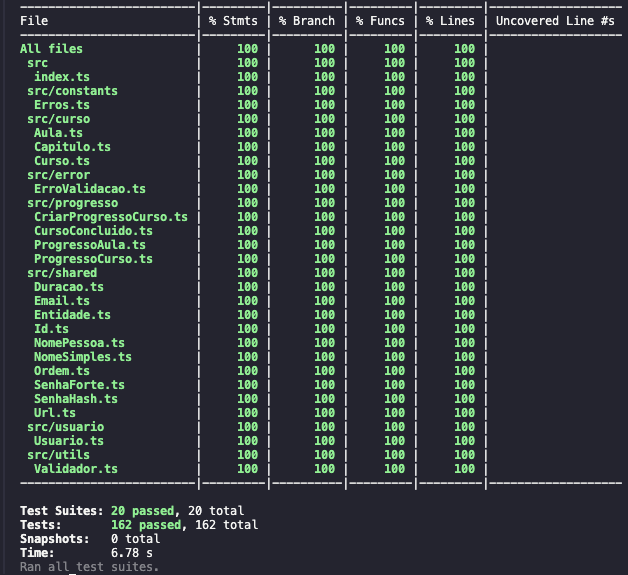

# Curso de Modelagem de Domínio

Dois projetos desenvolvidos durante um curso de **Modelagem de Domínio**, em TypeScript, com testes automatizados em Jest. Os exercícios apresentam os conceitos básicos, e o projeto EAD aplica esses conceitos às regras de uma plataforma de ensino a distância.

## Projetos

| Projeto | O que modela | Estrutura |
| --- | --- | --- |
| [Exercícios](exercicios/) | Cadastro de pessoas, validação e formatação de CPF, agrupamento pela região do CPF e quatro versões de um modelo anêmico de usuário para estudar encapsulamento e validação. | `src/core/` reúne `pessoa/`, `usuario/` e `shared/`. |
| [EAD](ead/) | Modelagem do conteúdo de cursos e do progresso dos alunos. | `src/` reúne `curso/`, `progresso/`, `usuario/` e `shared/`. |

Nos dois projetos, `test/` contém as suítes do Jest e `test/data/` reúne os builders de dados de teste.

## EAD — modelagem do domínio

- **Conteúdo do curso** — um `Curso` organiza capítulos, e cada `Capitulo` organiza suas aulas. O capítulo precisa ter pelo menos uma aula, e cada aula precisa ter duração positiva. Ao inserir, remover ou mover itens, o modelo recalcula a ordem. Quando o curso é construído com seus capítulos, a carga horária e a quantidade de aulas são derivadas desse conteúdo. [Código de cursos](ead/src/curso/)
- **Acompanhamento do aluno** — `ProgressoCurso` mantém a aula selecionada e reúne os registros de `ProgressoAula`, com datas de início e conclusão. O percentual assistido usa a duração das aulas concluídas em relação à duração total. O modelo também estima risco de fraude a partir de intervalos curtos entre os inícios de aulas consecutivas. [Código de progresso](ead/src/progresso/)
- **Sincronização com o conteúdo** — `CriarProgressoCurso` cria o acompanhamento a partir das aulas do curso ou o sincroniza com uma versão atualizada. Ao sincronizar, preserva as datas das aulas que mantiveram o identificador e a duração. Aulas novas ou com duração alterada entram sem histórico de início e conclusão. [Criação e sincronização do progresso](ead/src/progresso/CriarProgressoCurso.ts)
- **Usuário** — `Usuario` tem identidade própria e compõe seu estado com tipos de domínio para nome, e-mail e hash de senha opcional. [Entidade Usuário](ead/src/usuario/Usuario.ts)

### Conceitos e padrões aplicados

- **Entidades, composição e invariantes (DDD)** — entidades são comparadas pelo identificador. `Curso` e `Capitulo` concentram as operações sobre suas coleções e expõem ações do domínio, como `moverCapitulo` e `adicionarAula`. Em operações de alteração, `clone` cria uma nova instância com a mesma identidade e passa novamente pelas validações do construtor. [Classe base Entidade](ead/src/shared/Entidade.ts)
- **Objetos de valor** — `Email`, `Url`, `Duracao` e `Ordem` dão significado aos dados e encapsulam suas regras. `Duracao`, por exemplo, representa o tempo em segundos, valida valores negativos e oferece operações de soma e formatação. [Tipos compartilhados](ead/src/shared/)
- **Factory** — `CriarProgressoCurso` concentra a montagem de `ProgressoCurso`. A classe transforma a estrutura de aulas do curso em registros de acompanhamento e reaproveita essa lógica na sincronização. [Factory de progresso](ead/src/progresso/CriarProgressoCurso.ts)
- **Observer e evento de domínio** — quando o progresso passa para concluído, `ProgressoCurso` cria o evento `CursoConcluido` e chama os observadores registrados pelo contrato `ObservadorEventoDominio`. Os observadores recebem o evento e podem reagir à conclusão. [Implementação em ProgressoCurso](ead/src/progresso/ProgressoCurso.ts)
- **Test Data Builder** — classes como `CursoBuilder` e `ProgressoCursoBuilder` montam cenários com valores padrão e permitem ajustar os dados relevantes para cada teste. O projeto Exercícios aplica a mesma técnica com `PessoaBuilder`. [Builders do EAD](ead/test/data/) · [Builder de Exercícios](exercicios/test/data/)

## Como rodar os testes

Com Node.js e npm instalados, execute os comandos na raiz do repositório. O Jest gera o relatório de cobertura automaticamente nos dois projetos.

```bash
(cd exercicios && npm ci && npm test)
(cd ead && npm ci && npm test)
```

## Cobertura de testes do EAD

**100% de cobertura** de instruções, ramificações, funções e linhas, com **162 testes aprovados em 20 suítes**.


